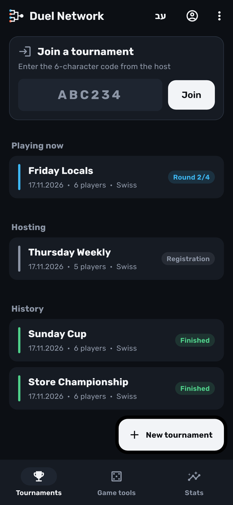
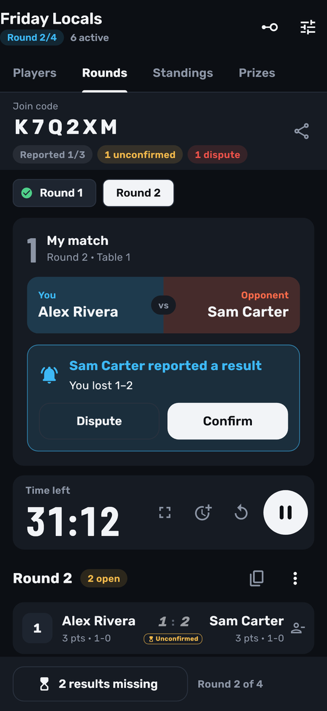
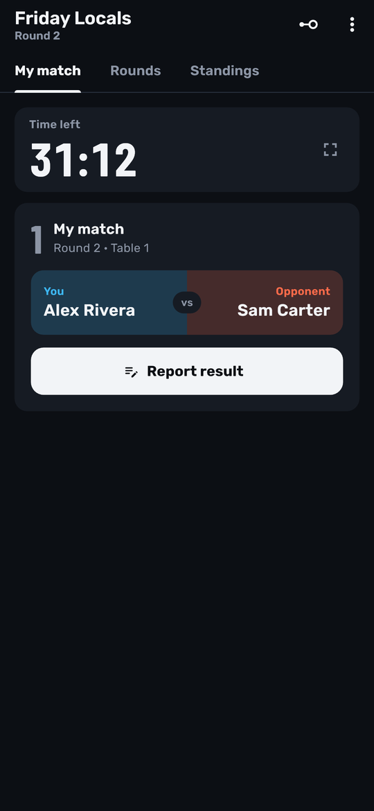
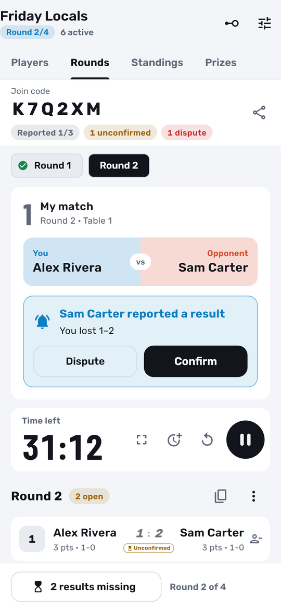
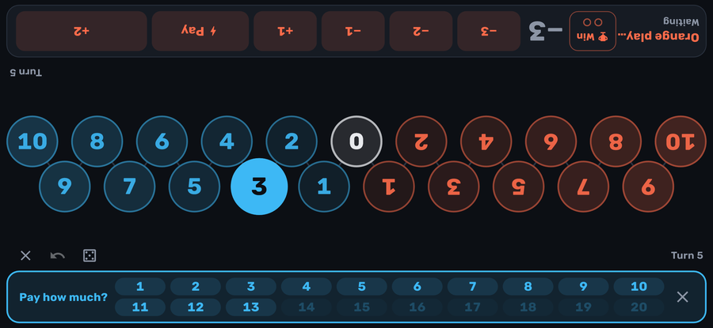

# Duel Network

[](https://github.com/galpartuk/zira/actions/workflows/ci.yml)

A tournament manager for local trading-card events. The organiser runs the event from their phone; players join with a
6-character code, see their table, and report their own results. Built with Flutter (Android + web) and Firebase.

**Live web app:** https://duel-network.web.app

<p>




</p>
<p>

</p>

## What it does

- **Swiss and round-robin pairing**, top cut with a third-place match, byes, drops and late entries.
- **Standings like official events:** points → OMW% → OOMW% → fixed random draw, with a configurable OMW floor.
- **Online tournaments:** players join by code, the opponent confirms each reported result, disputes go to the host,
  and each round is a draft until the host sends it out.
- **Round timer** with overtime and an alarm, shared with every player's screen.
- **Prize split** in money or booster packs; pairings and standings copied to WhatsApp in one tap.
- **Personal history and stats:** decks played, results per opponent deck.
- **Table tools:** a two-sided Digimon memory gauge, dice, coin, rock-paper-scissors.
- **English and Hebrew**, with full right-to-left layout; dark and light themes.

Used at real local events.

## How it is built

```
lib/engine/   Pure Dart rules: pairing, standings, tiebreakers, top cut, prizes, claims. No Flutter imports.
lib/state/    App state (ChangeNotifier) and the sync between the host's phone and Firestore.
lib/cloud/    The only code that talks to Firebase (auth, tournament store, claims, history).
lib/screens/  Screens and tabs.   lib/tools/  Table tools.   lib/widgets/  Shared widgets.
```

- **One writer per tournament.** Only the host's phone writes the tournament document. Players write two small
  things: their entry (join / drop) and their claim about a match result. The host's phone reads those and applies
  them through the rules engine. This removes write conflicts and keeps the Firestore security rules short and strict
  (`firestore.rules`, tested against the emulator in `firebase/rules.test.mjs`).
- **Rules are data in, data out.** Everything a judge could argue about lives in `lib/engine/` as plain functions,
  so it is tested without a UI: `resolveClaims` turns two players' reports into *confirmed*, *pending* or *disputed*.
- **Storage behind an interface.** `AppState` takes a `TournamentStore`: local preferences offline and in tests,
  Firestore once signed in.
- **No text in the engine.** The engine returns values; `lib/l10n.dart` turns them into English or Hebrew.

## Tests

160+ automated tests: unit tests for the rules engine, widget tests for the host and player flows against an
in-memory Firestore, and layout tests in both languages with the real font to catch overflow.

```bash
flutter analyze lib test tool
flutter test
cd firebase && npm test          # security rules, needs the Firestore emulator (JDK 21)
```

Screens for design review are rendered from sample data: `flutter test tool/shots --update-goldens`.

## Build

```bash
flutter build apk --release --split-per-abi
flutter build web --release
```

Release signing reads `android/key.properties`, which is not in the repository.

## Author

Designed and built by **Gal Partuk**, full-stack developer.
[LinkedIn](https://www.linkedin.com/in/partuk-gal) · [GitHub](https://github.com/galpartuk) · galpartuk007@gmail.com

Duel Network is an independent, fan-made tool. It is not affiliated with or endorsed by Bandai.
