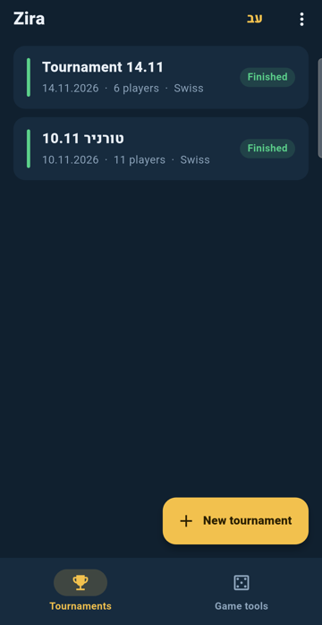
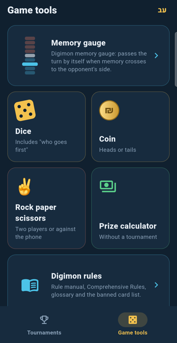

# Zira — tournament manager

An Android app (Flutter) for running local trading-card tournaments from one phone. English by default, Hebrew with full RTL.

<p>
  
</p>

- **Swiss and round-robin pairing**, top cut with a third-place match, round timer, drops and late entries.
- **Standings like official events:** points → OMW% → OOMW% → fixed random draw, byes counted as wins, time-outs as 0-0 draws.
- **Prize split** in money or booster packs; pairings and standings copied to WhatsApp in one tap.
- **Table tools:** a two-sided Digimon memory gauge, dice ("who goes first"), coin, rock-paper-scissors.
- All rules logic lives in `lib/engine/` (pure Dart, no Flutter imports) and is covered by unit tests.

Used at real local events.

---

# זירה — ניהול טורנירים

אפליקציית אנדרואיד (Flutter) לניהול טורנירי קלפים, בעברית:

- סוויס וראונד רובין, טופ קאט (נוקאאוט) עם משחק על המקום השלישי
- דירוג לפי נקודות ← OMW% ← OOMW% ← הגרלה (כמו בטורנירי Bandai / Digimon)
- שעון סיבוב, פרישות, הצטרפות באיחור, העתקת זיווגים/דירוג לוואטסאפ
- טבלת חלוקת פרסים אוטומטית (כסף או בוסטרים)
- כלי משחק: מד זיכרון לדיג׳ימון, קוביות ("מי מתחיל"), מטבע, אבן נייר ומספריים

## פיתוח

```bash
flutter test
flutter build apk --release --split-per-abi   # תמיד split — ראו CLAUDE.md
```

החתימה: `android/key.properties` (לא בגיט) מצביע על `C:\Users\Owner\keys\zira-release.jks`.
